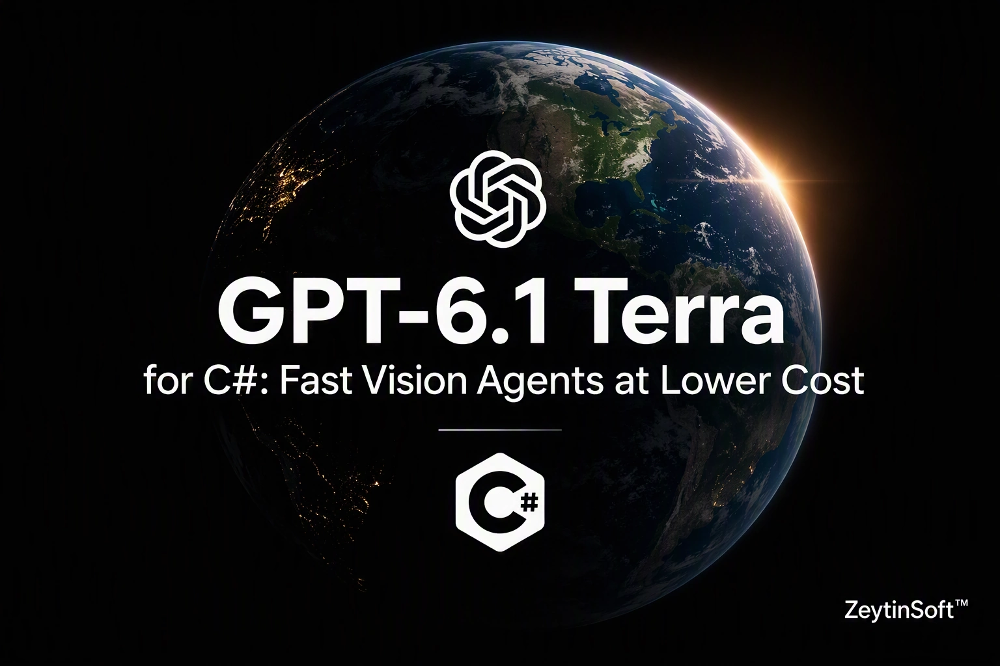

# GPT-6.1 Terra for C# Developers

> A runnable .NET 10 console app that calls **GPT-6.1 Terra** in **Microsoft Foundry** through the Responses API, covering screenshot analysis and a PDF invoice agent with a tool call and structured output.



[](LICENSE)
[](CONTRIBUTING.md)

- ⭐ If this sample helps you, star the repo so other .NET developers can find it.
- 🔁 Related: [GPT-6.1 Sol C# Demo](https://github.com/taswar/Gpt-6.1-Sol-CSharp-Demo)
- For more C# samples using other AI models, see [AI models for C# developers](https://taswar.zeytinsoft.com/foundry-ai-models-csharp/?utm_source=github&utm_medium=readme&utm_campaign=GPT-6-1-Terra-CSharp-Sample&utm_content=ai-models-hub)
- For my free ebook on prompt engineering, see [Prompt Engineering for .NET Developers](https://github.com/taswar/PromptEngineeringForDotNetDevelopers)

It's one `Program.cs` that posts JSON to `/openai/v1/responses` with `HttpClient`, with no SDK wrapper in between, so you can see exactly what goes over the wire. Each example prints its token usage, so you can see what the work costs before you put it into a pipeline.

## What's inside

| # | Example | What it shows |
|---|---------|---------------|
| 1 | **Read a screenshot** | Sends `expense-form.png` as an `input_image` and asks what the user is trying to do, what's filled in, what blocks them and which control to use next. |
| 2 | **Review a PDF invoice** | Sends `invoice.pdf` as an `input_file`, lets Terra call a `check_supplier` tool, and deserializes the strict JSON-schema answer into an `InvoiceReview` C# record. |

Each example prints a usage line like this one:

```
[terra] calls=2 input=3120 cached=0 output=412 reasoning=128 elapsed=7.4s
```

## Prerequisites

- **.NET 10 SDK**
- An Azure subscription with a **Microsoft Foundry** resource and a **GPT-6.1 Terra** deployment
- One way to authenticate:
  - **Entra ID (recommended):** the **Azure CLI** signed in with `az login`, and the **Cognitive Services OpenAI User** role on the resource. The app uses `DefaultAzureCredential`.
  - **API key:** set `AZURE_OPENAI_API_KEY` and the app sends it instead of a token.

## Run it

**1. Clone the repo and store your settings** (user secrets are kept outside the repo):

```bash
git clone https://github.com/taswar/GPT-6-1-Terra-CSharp-Sample.git
cd GPT-6-1-Terra-CSharp-Sample
dotnet user-secrets set "AZURE_OPENAI_ENDPOINT" "https://<your-resource>.openai.azure.com"
dotnet user-secrets set "AZURE_OPENAI_DEPLOYMENT" "<your-deployment-name>"
# Optional. Leave it out to sign in with Entra ID.
dotnet user-secrets set "AZURE_OPENAI_API_KEY" "<your-key>"
```

Use the resource's base endpoint. The app appends `/openai/v1/responses` itself. `AZURE_OPENAI_DEPLOYMENT` defaults to `gpt-6.1-terra`. Environment variables with the same names work too, and override user secrets.

**2. Sign in and run** from the project folder, where the sample files are:

```bash
az login
dotnet run
```

**3. Run one example at a time:**

```bash
dotnet run -- 1     # screenshot
dotnet run -- 2     # PDF invoice
dotnet run -- all   # both (the default)
```

## How the invoice agent works

Example 2 is a small agent loop written by hand:

1. The first request sends the PDF, the instructions, the `check_supplier` tool and the `invoice_review` JSON schema.
2. Terra replies with a `function_call`. The app runs `CheckSupplierAsync` and sends back a `function_call_output`.
3. Follow-up requests use `previous_response_id`, so the service keeps the conversation, including reasoning items, and the app doesn't resend the PDF.
4. When there are no more tool calls, the final `output_text` is JSON that matches the schema, and it's deserialized with `JsonNamingPolicy.SnakeCaseLower`:

```csharp
record InvoiceReview(
    string SupplierName, bool SupplierOnFile, string InvoiceNumber, string InvoiceDate,
    string PoNumber, string Currency, decimal Total, bool RequiresApproval, List<string> Issues);
```

The loop stops after five rounds as a safety limit. Strict mode needs every schema property listed in `required` and `additionalProperties` set to `false`.

## Good to know

- **Live calls cost money.** One full run makes at least three model requests: one for Example 1, and two or more for Example 2 while it uses the tool. Images use `detail: high`, which reads small text but costs more tokens than `low`.
- **The supplier lookup is simulated.** `CheckSupplierAsync` is a hard-coded dictionary standing in for your ERP or vendor master. Nothing touches a real system.
- **Output varies.** Responses are model-generated and differ between runs. Compare token counts across several runs, not just one.
- **Every run shares one 5-minute timeout,** and each HTTP request has a 2-minute network timeout.
- **Supported images** are PNG, JPEG, WebP and non-animated GIF.

## Troubleshooting

| Error | Likely cause | Fix |
|-------|--------------|-----|
| `InvalidOperationException: Set AZURE_OPENAI_ENDPOINT ...` | User secrets are missing | Run the `dotnet user-secrets set` commands from inside the project folder |
| `FileNotFoundException: Run from the project folder ...` | `dotnet run` was started from another folder | `cd` into the project folder, where `expense-form.png` and `invoice.pdf` are |
| `Responses API returned 404` | `AZURE_OPENAI_DEPLOYMENT` doesn't match a deployment on the resource | Set it to the exact deployment name. A brand-new deployment can take about 5 minutes to become available. |
| `Responses API returned 401` / `403` | Missing role, wrong tenant, or a bad API key | Assign **Cognitive Services OpenAI User** and run `az login --tenant <id>`, or check `AZURE_OPENAI_API_KEY` |
| `The model returned no invoice review` | The final answer wasn't valid schema JSON | Rerun, and check the `[tool]` lines to see whether the tool loop finished |

## Dependencies

| Package | Version | Purpose |
|---------|---------|---------|
| `Azure.Identity` | 1.21.0 | `DefaultAzureCredential` for Entra ID sign-in |
| `Microsoft.Extensions.Configuration.UserSecrets` | 10.0.14 | Local development secrets |
| `Microsoft.Extensions.Configuration.EnvironmentVariables` | 10.0.14 | Settings from environment variables |

## Project layout

```
GPT-6-1-Terra-CSharp-Sample.csproj   Target framework, NuGet references, UserSecretsId
Program.cs                           Both examples, TerraClient, the usage reporter
expense-form.png                     Screenshot for Example 1
invoice.pdf                          Invoice for Example 2
CONTRIBUTING.md                      How to contribute
```

## Learn more

- [GPT-6.1 Sol for C# Developers (blog post)](https://taswar.zeytinsoft.com/gpt-6-1-sol-csharp-developers-guide/?utm_source=github&utm_medium=readme&utm_campaign=GPT-6-1-Terra-CSharp-Sample&utm_content=gpt-6-1-sol-csharp-developers-guide)
- [Azure OpenAI Responses API](https://learn.microsoft.com/azure/ai-foundry/openai/how-to/responses)
- [.NET Secret Manager](https://learn.microsoft.com/aspnet/core/security/app-secrets)

## License

MIT. See [LICENSE](LICENSE).

If this saved you time, a ⭐ helps other .NET developers find it.
